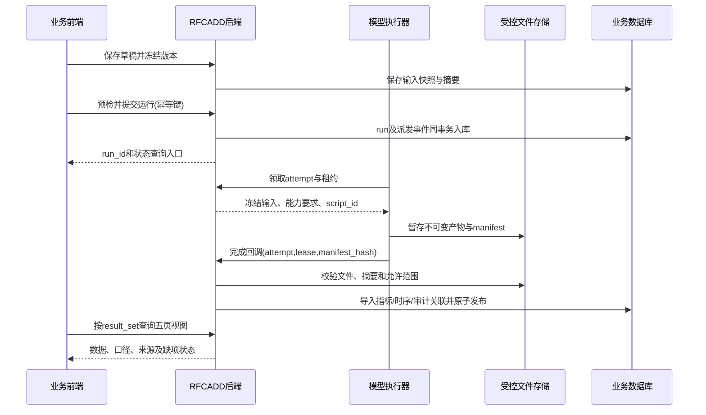

# 给业务前后端与模型程序的对接合同草案

日期：2026-10-19。状态：建议合同，不是已上线API。先读[总体方案](01_solution.md)，再按[工作单](03_implementation_handoff.md)实施。以下JSON表示业务 `R.data` 内部结构，响应封装、分页、鉴权和错误码须沿用tianjin-waterx规范。

最新冻结补充见[07 R1实施单](07_r1_authorized_work_order.md)：字段级身份、选择器枚举、平台来源、可移植审计与租户边界以该单为准。[05](05_management_and_creation.md)明确新建表单和未知下边界策略；下边界不再要求普通用户输入，但不放松引擎真实计算门禁。

逐页VO字段草案见[五页字段目录](04_page_field_catalog.md)。本接口表并非已冻结的完整OpenAPI；必填性、错误码及产品policy仍需R0审查后冻结，不能据示例直接生成生产代码。

## 1. 三方职责

| 角色 | 负责 | 不负责 |
| --- | --- | --- |
| waterx-front | 场景编辑、预检展示、任务状态、选择结果集、五页展示、人工避险编辑 | 不算损失/受灾人口、不从动画进度造指标、不拼SQL、不直接连接数据库/启动脚本 |
| waterx/waterx-rfcadd | 权限、场景版本、任务编排、输入快照、受控产物服务、入库校验/发布、查询API、审计 | 不在HTTP请求线程同步跑长模型，不把模型输出未经验证透传到生产页面 |
| 2d-hydrodynamics worker/adapter | 消费已冻结请求、能力预检、运行允许的引擎、导出原生结果/派生产品/质量/调闸证据、完成报告 | 不自行更改方案规则/业务主数据，不冒充真实指令执行，不凭缺数据生成风险或路线 |

已有单机workflow/调闸数据库接口继续可用。新平台集成应通过独立适配层，不把Java服务依赖嵌入数值核心，也不覆盖旧输出契约。

## 2. 面向业务人员的完整流程

1. **建方案**：选择区域、事件时间、数据来源、模型类型，引用规则及资料；保存草稿，不计算。
2. **冻结输入**：后端生成版本，记录地形/网格、边界、雨量、初值、糙率、规则、资产及统计policy的不可变快照和摘要。
3. **预检**：检查数据齐全、坐标/高程基准一致、时间覆盖、边界/引擎支持、资源预算及必需产品能力。问题定位到字段/对象；不支持开放边界的引擎不能接收开放边界任务。
4. **提交推演**：前端带幂等键提交一次，立即得到run_id；重复点击得到同一任务，冲突配置返回冲突错误。
5. **后台计算**：后端分配attempt和唯一script_id，worker按受控请求运行；前端只展示状态/阶段。不得把“请求已接收”显示为“计算完成”。
6. **后处理与校验**：导出帧、曲线、指标、G1审计和产品清单，检查原始数值、质量、时间范围、网格身份、文件摘要与计量口径。
7. **入库发布**：后端验证完整结果包，在事务中登记查询数据和审计关联，最后发布result_set。部分文件/部分插入失败不会成为可见的成功结果。
8. **五页查看**：首次选定run/result_set，五页共享该上下文；切换方案/版本后清空旧帧/请求缓存，所有返回再核对result_set_id。
9. **人工避险与审批**：引用当前结果及资产快照建立避险版本，保存路线/安置分配；不回写水动力结果。审批/执行记录与规划数据分开。
10. **重算与归档**：新输入生成新版本，新计算生成新run；技术重试生成新attempt；保留旧发布结果，明确哪次被用户选中。



## 3. 场景输入请求的最低合同

| 字段 | 类型/默认 | 验证 |
| --- | --- | --- |
| scenarioVersionId | 字符串ID，必填 | 属于当前tenant/project，已冻结 |
| engineMode | 枚举，必填 | 服务端白名单且版本支持；区分structured replay、experimental triangular和受信外部结果导入 |
| regionIds | 字符串数组，必填非空 | 稳定区域ID，声明的全部区域都有输入/输出覆盖；禁止仅靠区域名称匹配 |
| timeOriginLocal / timeZone | 空格格式日期时间或null；timeZone必填 | 即使原点为null，仍声明显示时区（本业务Asia/Shanghai），但不据此生成绝对日期；业务DTO遵循 `yyyy-MM-dd HH:mm:ss`。适配层仅在原点已知时生成模型ISO8601；未知原点阻断绝对日期产品或显示相对时间 |
| outputTimesS | 有限数值数组，必填 | 秒、从0严格递增；包含首尾及源项断点，遵守实际引擎的间隔/数量限制 |
| inputManifestId/hash | 字符串及SHA256，必填 | 输入URI仅服务端允许的存储对象，不接受任意HTTP地址/磁盘路径 |
| requestedProducts | 受控枚举数组，必填 | 分required/optional；没有历时/流场/风险能力时阻断必需产品，选配产品返回缺项 |
| metricPolicyVersion | 字符串，必填 | 湿阈值、分级、采样积分、资产关联和汇总规则已冻结 |
| scriptId | 普通前端提交不提供，属于后端生成的执行上下文 | 后端创建attempt时生成并持久化；worker不可重生成。旧CLI/有权限的运维入口可显式指定，但必须校验与attempt绑定一致 |

rainfall enabled=false与缺失配置不是同一意思；空间变化雨量目前不在三角首版范围。边界Q/水位、原单位/高程基准、source角色、时间插值和实际应用状态需显式保留。G1规则日志不得自动改写边界条件。

script_id沿既有1至96 ASCII规则，平台对 `(tenant_id,script_id)` 做唯一约束；显式碰撞拒绝，自动生成碰撞由后端在派发前重新生成并重试插入。日期使用派发当时北京时间，Unix纳秒由墙上时钟Instant换算，不能把Java `System.nanoTime()` 当Unix时间戳。worker返回不一致ID直接拒绝；技术重试新attempt使用新script_id。该ID不是代码版本、不是事件时间，也不是请求幂等键。

## 4. 建议新增API清单

业务已有 `/api/rfcadd/dispatch/plan|rule|joint/...`，其中plan是文档资料。以下建议使用 `/api/rfcadd/rehearsal` 外部前缀；实际Controller路径与网关映射由业务实现核对，禁止把此表当作已存在的端点。

| 方法与相对路径 | 功能/返回 |
| --- | --- |
| POST /scenarios；GET /scenarios | 创建/分页检索计算场景；不是旧资料目录CRUD |
| GET /templates；GET /templates/{id}/versions/{version} | 查询内置/授权模板和来源、缺项、历史事件；不可把模板runnable=false改成已完成 |
| POST /templates/{id}/clone | 克隆不可变模板为本租户新草稿，保留来源及派生记录 |
| POST /scenarios/{id}/favorite；POST /scenarios/{id}/archive | 用户收藏/逻辑归档；内置模板与活跃任务受独立保护，不删除审计链 |
| GET /scenarios/{id}；POST /scenarios/{id}/draft/save | 查看/编辑草稿；带rowVersion乐观锁 |
| POST /scenarios/{id}/versions | 冻结版本；返回versionId/inputHash，不原地改发布版本 |
| POST /versions/{id}/preflight | 返回eligible、能力矩阵、blockers/warnings及字段路径 |
| POST /runs | 提交versionId+产品要求；Idempotency-Key必填；返回runId、state和查询地址 |
| GET /runs/{runId} | 状态、attempt、scriptId、阶段、最后心跳、错误及已发布resultSetId |
| POST /runs/{runId}/cancel；POST /runs/{runId}/retry | 协作取消/技术重试，均带expectedVersion；物理输入变化不得走retry |
| GET /result-sets/{id}/overview | 全程指标、结论、质量/来源、分区与产品可用性 |
| GET /result-sets/{id}/frames | 完整或分页帧索引及time_s，不靠前端duration自行造帧 |
| GET /result-sets/{id}/frames/{index}/overview | 该帧指标/分级，与地图同一时刻 |
| GET /result-sets/{id}/series | 按对象ID、quantity、role返回曲线，时间/单位/datum必带 |
| GET /result-sets/{id}/layers | 图层manifest，包括变量、静态聚合/时刻、图例、CRS/网格/NoData、受控资源ID |
| GET /result-sets/{id}/exposure | 村庄/人口/道路/耕地/房屋风险分页，带未匹配/覆盖统计 |
| GET /result-sets/{id}/gate-audit | 受权的G1事件，关联script/attempt；不可直接暴露无租户的旧审计表 |
| GET /artifacts/{id}/content | 鉴权下载或短期URL，支持所需range/cache；不返回本地磁盘路径 |
| POST /evacuation/revisions；GET /evacuation/revisions/{id} | 人工/外部避险方案版本，绑定result_set与资产快照 |
| POST /evacuation/revisions/{id}/draft/save | 保存分配/路线变更，带版本锁；已批准版本修改生成新版本 |
| POST /evacuation/revisions/{id}/checks | 校验关联/容量/时间与风险，不能等同于安全批准 |

已有转移基础资料 `att_fsda_relocate_sum/item` 和 `/basic/flood-storage-area/relocate-*`、`/basic/resettlement`、`/basic/safe-zone` 应引用并形成快照；新接口保存的是**某次风险结果之上的方案版本**，不复制或自动覆盖这些基础资料。

内部worker协议另设受认证端点：claim、heartbeat、complete、fail、ackCancel。只有受信执行器可调用，不走浏览器用户可编辑的任意回调地址。完成消息必须包含runId、attemptId、leaseToken、manifestId/hash；重复消息幂等，旧attempt或过期租约拒绝发布。

### 查询范围的强制规则

overview、frames/{index}/overview、series、layers、exposure、gate-audit均须显式携带 `scopeId`（manifest列出的区域或已定义方案并集scope）。全程产品另带 `aggregation`；逐帧端点强制 `aggregation=FRAME` 且frameIndex来自路径，二者冲突返回校验错误。到达/历时/逐格最大产品的aggregation由产品目录限定，不接受任意拼接。帧索引本身是整个result_set的时间目录，但返回可用区域/产品覆盖。

每个响应回显 `{resultSetId,scopeId,aggregation,frameIndex,timeS,metricPolicyVersion}`，前端比对后才应用。未提供/未获权的scope不得默认为另一区域；地图缩放bbox只裁剪显示，不隐式改变统计范围。对多个区域汇总必须请求已定义的并集scope，不在浏览器相加。

管理列表另外提供simulationStart范围、regionId、scenario/run状态、keyword、starredOnly和分页/排序，明确createdAt为另一字段；卡片的结果指标必须关联当前version所选已发布result_set，否则为未计算。新建表单字段与四类来源的条件校验见05，不再沿用演示forecast默认曲线或隐藏下边界默认水位。

## 5. 查询对象示例

以下为结构示意，ID为说明占位；不是可导入的真实运行数据。正式模型由OpenAPI/JSON Schema冻结后生成前后端类型。

```json
{
  "resultSetId": "result-id",
  "scenarioVersionId": "version-id",
  "runId": "run-id",
  "attemptId": "attempt-id",
  "scriptId": "20261019-<UnixNanoseconds>",
  "context": {
    "scopeId": "region-id",
    "productCode": "maximum_depth",
    "aggregation": "MAX_OVER_WINDOW",
    "frameIndex": null,
    "timeS": null,
    "timeOriginLocal": "2023-08-01 00:00:00",
    "timeZone": "Asia/Shanghai",
    "metricPolicyVersion": "reviewed-policy-id"
  },
  "quality": {
    "provenance": "SYNTHETIC_MODEL",
    "engineeringValidated": false,
    "publicationState": "STAGED",
    "usage": "TEST_ONLY",
    "productCoverage": [
      {"product": "depth", "required": true, "coverageStatus": "COMPLETE"},
      {"product": "duration", "required": false, "coverageStatus": "UNSUPPORTED"}
    ]
  },
  "metrics": [
    {"code": "maximum_depth", "value": null, "unit": "m", "status": "NOT_COMPUTED", "reasonCode": "ADAPTER_NOT_READY"}
  ],
  "capabilities": {
    "depth": {"rawAvailable": true, "adapterReady": false, "qualityPassed": false, "publishable": false},
    "evacuationOptimization": {"rawAvailable": false, "adapterReady": false, "qualityPassed": false, "publishable": false}
  },
  "warnings": ["Experimental synthetic scope; not an operational forecast"]
}
```

数值是数值，单位/格式/质量是另外的字段；NULL必须有reason。状态建议区分AVAILABLE、NOT_COMPUTED、UNSUPPORTED、MISSING_INPUT、PARTIAL、NOT_APPLICABLE；有效0仍AVAILABLE。金额/Long/高精度字段按照业务序列化规范，不让浏览器二次计算权威统计。

时间轴的唯一权威是frames：frameIndex、timeS、timeLocal/timeZone或null、quality。业务日期使用既有空格格式，模型内部仍保留高精度时间和带时区ISO8601；不要全仓修改Jackson/日期规则。图表降采样需标明displayOnly、原始点数和保峰值方法；摘要与积分用原始序列计算，不用降采样后的绘图点。

地图的唯一权威是layer manifest：resultSetId、regionId、productCode、time/aggregation、meshId、topologyFormat、nativeCRS、displayCRS、verticalDatum、bounds、nodata、validCoverage、legendVersion、resourceId/hash。三角和规则网格各走适配器，不把两种数组强制同维。

## 6. worker输出包与原子发布

建议新增独立导出包 `rehearsal-result-package-v1`，不改变原NetCDF格式。最低清单：

```text
manifest.json                 身份、schema/代码/输入摘要、引擎能力、区域/时间、产品状态
quality.json                  质量门禁、守恒/源项、覆盖与缺项，不只存passed总数
summary.json                  受控指标与结论引用
frames.json                   真实帧索引
series/                       小型过程线
statistics/                   分级/资产统计；缺产品显式标注，不生成伪数据文件
audit/                        原G1 CSV/JSON及一致性摘要
native/                       原生NetCDF或受控引用
layers/                       可视化产品或受控引用
```

发布步骤：

1. worker在独立attempt目录/对象前缀写文件；同名不覆盖，先临时名后封存。
2. 按真实文件生成manifest，记录相对键、字节数、SHA256、格式/单位/CRS；不允许 `../`、外部回调URL和任意绝对路径。
3. 完成回调仅报告产物准备就绪，不直接把任务标成功。
4. 后端检查身份、权限、租约、输入摘要、必需产品、文件存在/大小/hash及语义一致性，再分批导入暂存结果集。大批量导入可多事务，但暂存集合始终不可见。
5. 先取得全部必需G1入库的持久回执并验证身份/摘要/数量，再在业务数据库最终事务中校验暂存导入数量/摘要、保存审计关联与回执、设置result_set=PUBLISHED和run=SUCCEEDED。更新指针需比较expectedVersion/attempt；不得仅凭进程退出0发布。
6. 文件已上传但DB失败时保留待恢复对象并登记清理策略；同包重试返回相同结果集，不重复导入。DB与文件存储不伪称单个分布式事务。
7. 必需水动力/审计产品失败阻断发布；选配人口/损失/历时不可用可以在明示产品状态下发布其余产品，不能给整页贴“所有工程结果通过”。

生产平台推荐由**业务发布服务唯一负责结果元数据与查询表写入**。worker导出审计文件，由发布侧受控导入/适配任务完成原G1入库和关联；旧本地CLI直接入库路径保持兼容。两种模式须显式配置和测试，不能同时抢写同一结果，也不能关闭旧入库后漏掉发布侧审计。数据库账号按最小权限配置，不使用当前本地开发的高权限账号作为生产凭据。

**事务边界必须在R0确认。** 现有Python G1导入自行提交事务，即使与业务表同库也不能自动纳入Java事务。默认设计为可恢复的 `AUDIT_INGESTED → RESULT_PUBLISHED` 两步：G1先幂等落库、记录回执，业务事务仅原子发布查询可见性。中间失败保留未公开关联的审计批次，重试复用，不承诺跨库原子写入；对账发现必需审计丢失时标异常并阻止新发布。若将来同库同连接统一事务，须明确改造/验证后才能声称两者共同原子提交。不默认引入2PC，不靠删除版本/批次掩盖失败。

现有G1 v2多租户缺口必须先解决：增加明确所有权迁移/租户关联与复合校验，不从前端传入tenant_id认领批次。历史无归属审计仅管理员隔离查看，不可默认归入当前租户。

## 7. 状态和失败语义

场景草稿/审批状态与计算状态分开；撤离方案审批、现场执行状态也不能复用计算状态。

```text
CREATED -> VALIDATING -> QUEUED -> RUNNING -> POSTPROCESSING -> INGESTING -> SUCCEEDED
                    -> BLOCKED
任意非终态 -> FAILED
QUEUED/RUNNING等可取消态 -> CANCEL_REQUESTED -> CANCELLED
```

BLOCKED提供数据/能力缺口；FAILED提供stage、可公开错误码、retryable和关联诊断ID，详细堆栈仅服务器日志。SUCCEEDED只在结果发布事务成功后出现。技术重试保持同一不可变输入，但产生新attempt；重算则新run。取消请求不等于已取消，worker确认或租约策略处理前不伪称停止。取消与完成同时发生时使用数据库版本比较，不能在取消后悄悄发布。

接口错误至少涵盖INPUT_INVALID、ENGINE_CAPABILITY_UNSUPPORTED、TIME_COVERAGE_GAP、DATUM_MISMATCH、DATASET_NOT_ACCESSIBLE、IDEMPOTENCY_CONFLICT、STALE_VERSION、STALE_ATTEMPT、ARTIFACT_INCOMPLETE、CHECKSUM_MISMATCH、PRODUCT_UNAVAILABLE、QUALITY_GATE_FAILED。HTTP语义和业务R码映射由业务统一确定，不把权限失败包装成空列表。

## 8. 前端可直接执行的改造步骤

1. 新增请求service与类型定义，路径/返回R遵循已有封装；不直接在组件里fetch文件系统地址。
2. store只维护一个 `{scenarioId,versionId,runId,resultSetId,scopeId,frameIndex}` 上下文；加载子页请求带上下文，迟到响应若不匹配则丢弃。
3. 先取得run和result manifest，再开五页数据查询；切换计划取消旧请求、重置播放/图层/路线版本与缓存。
4. 概览卡片、过程卡片和三维卡片必须通过同一metric目录并显式传aggregation/frame；三维不能另造固定指标。
5. 播放速度/时间间隔只影响前端播放，不生成缺失帧、不重新计算统计；可视插值若启用必须标为display-only，不改变数值查询结果。
6. 没有AVAILABLE的流场/到达/历时资源，禁用控件并说明缺项；数据0显示0，NULL显示未计算及原因，加载中/失败/无结果分别显示。
7. 路线编辑写入当前避险草稿版本，带rowVersion；localStorage只可作含tenant+scenarioVersion+resultSet+evacuationRevision键的临时草稿，不作权威数据源。
8. demo模式独立开关且明显标识；正式模式断网/API失败不退回硬编码演示数据。
9. 同一result_set的预览与下载均鉴权；对象URL过期可刷新，不得为修复地图而把整个bucket公开。

这里的页面轮询仅在用户打开运行详情且任务未终结时使用，推荐复用已有SSE设施或有退避的状态查询；与已取消的聊天15分钟自动任务无关，不重建聊天自动任务。
